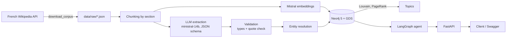
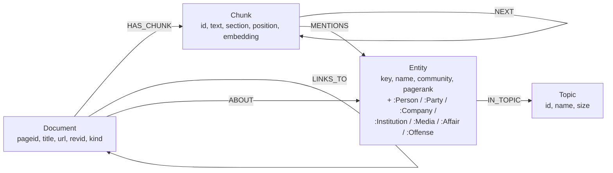
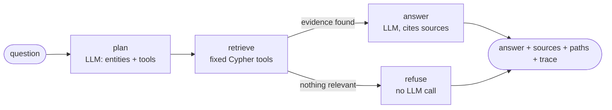
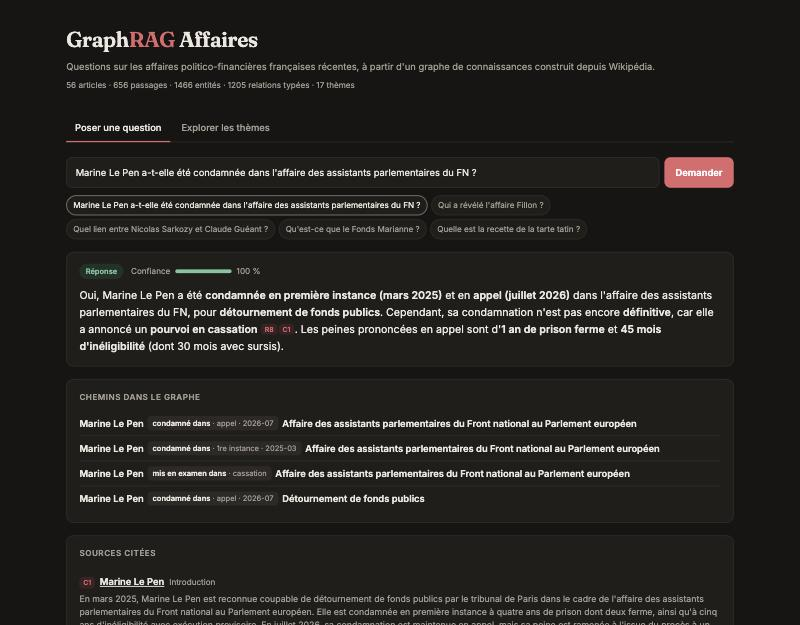
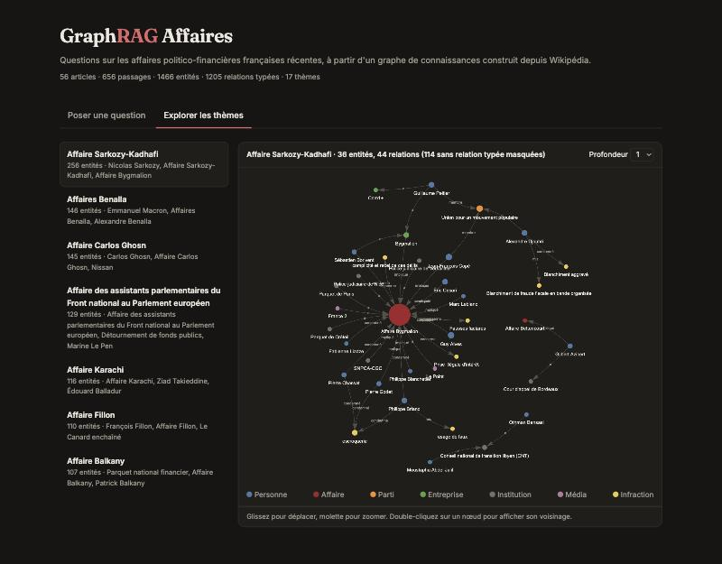
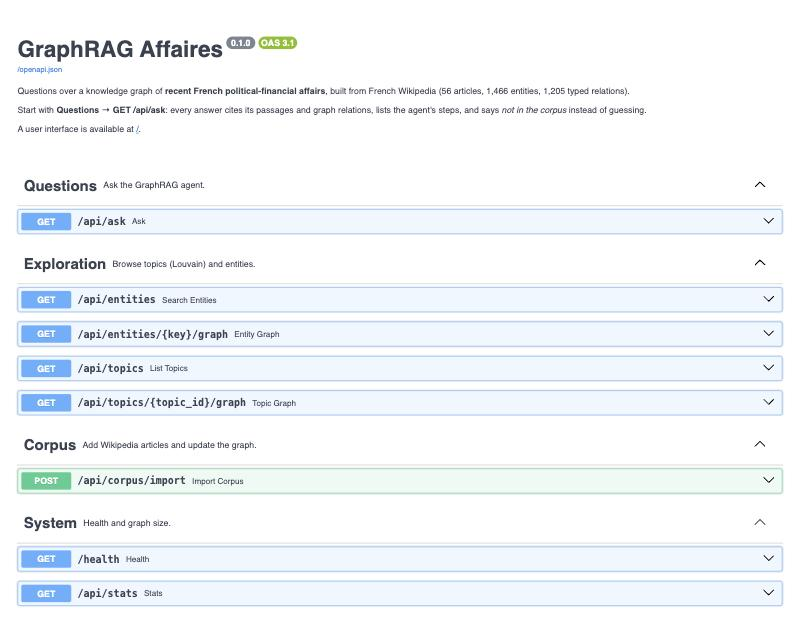

# GraphRAG Affaires


A question-answering assistant over a knowledge graph of **recent French
political-financial affairs** (McKinsey, Fonds Marianne, Bygmalion, Fillon,
Sarkozy-Kadhafi, assistants FN/MoDem, Benalla, Uber Files...), built from French
Wikipedia with Neo4j, FastAPI, LangGraph and Mistral.

Every answer cites the passages and graph relations it relies on, and the agent
says *"not in the corpus"* rather than inventing an answer.

```text
GET /api/ask?q=Marine Le Pen a-t-elle été condamnée dans l'affaire des assistants parlementaires ?
```

```json
{
  "status": "answered",
  "answer": "...",
  "confidence": 0.85,
  "sources": [{"id": "C1", "kind": "passage", "document": "...", "url": "..."},
              {"id": "R1", "kind": "relation", "text": "Marine Le Pen -[CONVICTED_IN first_instance, 2025]-> ..."}],
  "graph_paths": ["Marine Le Pen -[CONVICTED_IN first_instance, 2025]-> Affaire des assistants parlementaires du Front national au Parlement européen"],
  "tool_calls": [{"tool": "plan"}, {"tool": "search_passages"}, {"tool": "find_entities"}, {"tool": "entity_relations"}]
}
```

## Contents

- [Quick start](#quick-start)
- [Architecture](#architecture)
- [Corpus](#corpus)
- [Graph schema](#graph-schema)
- [Modelling choices and rejected alternatives](#modelling-choices-and-rejected-alternatives)
- [Avoiding hallucinated edges](#avoiding-hallucinated-edges)
- [The agent](#the-agent)
- [What you can ask](#what-you-can-ask)
- [Web interface and API](#web-interface-and-api)
- [Topics with GDS](#topics-with-gds)
- [Query performance](#query-performance)
- [Tests and quality](#tests-and-quality)
- [Limitations](#limitations)
- [Appendix: comparison with an AI-generated schema](#appendix-comparison-with-an-ai-generated-schema)

## Quick start

Requirements: Docker, Python 3.11+, a Mistral API key (the free tier is enough).

```bash
cp .env.example .env          # set NEO4J_PASSWORD and MISTRAL_API_KEY
make install                  # creates .venv and installs dependencies
docker compose up -d neo4j    # Neo4j 5.26 + GDS on :7474 / :7687
make ingest-cached            # graph from the cached LLM extractions: no chat calls (embeddings ~$0.03)
make topics                   # Louvain + PageRank
make run                      # API on http://localhost:8000/docs
```

Or everything in Docker: `make docker-run` starts Neo4j, the API and an Nginx
reverse proxy on http://localhost:8080 (rate limit of 10 questions per minute per
client on `/api/ask`); then run `make ingest-cached` and `make topics` from the host.

`POST /api/corpus/import` changes the graph and spends LLM credit: set
`ADMIN_API_KEY` in `.env` and send it in the `X-API-Key` header.

| Command | What it does |
|---|---|
| `make help` | List the commands |
| `make corpus` | Download the articles listed in `data/articles.csv` |
| `make ingest` | Chunk, embed, extract with the LLM and write the graph (new chunks only call the LLM) |
| `make ingest-cached` | Same, from `data/extracted/` only: no chat API calls |
| `make topics` | Detect topics with GDS |
| `make run` / `make docker-run` | Start the API locally / with Docker Compose |
| `make test` / `make lint` | Tests with coverage (fails under 60%) / pylint (fails under 9.5) |

## Architecture



| Folder | Content |
|---|---|
| `app/ingest/` | Wikipedia download, chunking, extraction schema and validation, entity resolution, Neo4j writer, GDS topics, pipeline |
| `app/agent/` | Retrieval tools (fixed Cypher) and the LangGraph workflow |
| `app/main.py` | FastAPI endpoints |
| `scripts/` | Command-line entry points (`download_corpus`, `ingest`, `topics`) |
| `data/` | Article list, raw articles, cached LLM extractions, ingestion report |
| `tests/` | Unit tests; Neo4j and the LLM are replaced by fakes |

## Corpus

56 French Wikipedia articles, hand-picked in `data/articles.csv` and downloaded by
`scripts/download_corpus.py`:

- **20 affairs** with judicial or political developments since 2020. Full text,
  without the reference sections, capped at 40,000 characters.
- **36 context pages** for the people, parties, courts, newspapers and companies
  involved. Intro only, so that long biographies do not swamp the affairs.

The list is curated rather than taken from the category
[Affaire politico-financière en France](https://fr.wikipedia.org/wiki/Catégorie:Affaire_politico-financière_en_France),
which mixes affairs from the 18th century to today and has no field for when an
affair happened.

Wikipedia links between these pages (509) become `LINKS_TO` edges without any LLM.
Text is licensed CC BY-SA 4.0 by Wikipedia contributors; `data/corpus_index.json`
lists the URL and revision of every article used.

## Graph schema



Typed relations between entities, all carrying `chunk_ids`, `evidence`,
`confidence`, `support` and `date`:

| Relation | From | To | Extra properties |
|---|---|---|---|
| `INVOLVED_IN` | Person, Company, Party, Institution | Affair | |
| `INDICTED_IN` | Person, Company, Party, Institution | Affair, Offense | `stage`, `final` |
| `CONVICTED_IN` | Person, Company, Party, Institution | Affair, Offense | `stage`, `final` |
| `ACQUITTED_IN` | Person, Company, Party, Institution | Affair, Offense | `stage`, `final` |
| `MEMBER_OF` | Person | Party, Institution | |
| `WORKED_FOR` | Person | Company, Institution, Party, Media | |
| `REVEALED` | Media | Affair | |
| `INVESTIGATED` | Institution | Affair | |
| `CONCERNS` | Affair | Offense | |

`stage` is one of `investigation`, `first_instance`, `appeal`, `cassation`,
`unknown`; legal relations are merged per stage, so a person convicted at first
instance and again on appeal has two edges.

Indexes: uniqueness constraints on `Document.pageid`, `Chunk.id`, `Entity.key`;
a range index on `Document.title`; a vector index on `Chunk.embedding` (1024
dimensions, cosine); full-text indexes on `Chunk.text` and `Entity.name`.

## Modelling choices and rejected alternatives

**Legal outcome as typed relations with a stage, not as a status property.**
"Indicted", "convicted" and "acquitted" are different facts with different
consequences, and in French law a first-instance conviction is not final while an
appeal is pending. Separate relation types make "who was convicted?" an exact
query, and `stage` / `final` let the agent say "convicted at first instance,
appeal pending" instead of just "convicted".
*Rejected:* a `status` string on the affair or a `sentence` string on the person
(the AI baseline's choice); it cannot say who was convicted at which stage.

**Offense as a node, not a property.** `(Affair)-[:CONCERNS]->(Offense)` and
`(Person)-[:CONVICTED_IN]->(Offense)` connect affairs to each other: "which other
affairs involve illegal campaign financing?" is one hop.
*Rejected:* a `charges` list property, which would need string matching across
nodes.

**One `Entity` label plus a type label**, instead of unrelated labels. A single
uniqueness constraint and full-text index cover all entities, while
`MATCH (p:Person)` still works. The key is `type:normalized name`, so the
Bygmalion company and the Bygmalion affair stay distinct.

**Provenance on every relation** (`chunk_ids`, `evidence`, `support`,
`confidence`). Every edge can be traced back to the passages that state it, and
`support` counts how many passages agree.
*Rejected:* reifying each statement as an `Assertion` node. It gives per-statement
provenance but doubles the graph and makes every traversal one hop longer; a list
of chunk ids on the edge is enough for citations.

**Affair pages versus context pages.** Biographies are cut to their intro so that
the graph is about the affairs, not about the whole career of each politician.

**Wikipedia links as free edges.** `LINKS_TO` comes from the articles' own links and
costs no LLM call; it is structure we can trust.

## Avoiding hallucinated edges

The LLM never writes to the graph directly. Each passage's extraction goes through
three checks in `app/ingest/extraction.py`, and a relation is dropped if:

1. **one of its ends is not an extracted entity** (`unknown_entity`);
2. **the entity types do not fit the relation** (`wrong_types`): only media can
   `REVEAL` an affair, only a person can be `MEMBER_OF` a party...;
3. **its quote is not in the passage** (`evidence_not_in_passage`): the LLM must
   copy the words that state the relation, and the quote is checked against the
   passage (ignoring case, accents and spacing).

A fourth rule applies when relations are merged: a legal relation is marked
`final` only if it is at the cassation stage or its quote says "définitif". The
LLM's own `final` flag is not trusted (see [Limitations](#limitations)).

The prompt also gives the article's subject and the list of canonical entity
names, and forbids turning an indictment into a conviction.

Results on the whole corpus (`data/ingest_report.json`):

| Step | Count |
|---|---|
| Passages sent to the LLM | 656 |
| Relations proposed by the LLM | 4,463 |
| Rejected: wrong entity types | 1,313 (29%) |
| Rejected: quote not in the passage | 748 (17%) |
| Rejected: unknown entity | 518 (12%) |
| **Kept** | **1,770 statements (40%), merged into 1,205 edges** |
| Entities after resolution | 1,466 |

The most frequent type errors were people used as employers ("Carlos Ghosn
WORKED_FOR Louis Schweitzer") and reversed relations ("Affaire Fillon CONCERNS
Penelope Fillon"). Two patterns that looked like errors were real and are allowed:
a person `MEMBER_OF` an institution (the Assemblée nationale), and a legal relation
pointing at the offense itself ("convicted of aggravated money laundering").

In a pilot, `ministral-8b` produced 11 relations on one passage and all 11 were
rejected; `ministral-14b` produced 5 and 4 passed. The checks are what make a small
free model usable.

Precision is preferred over recall: a missing edge makes the agent fall back on
passages, a wrong edge would make it state something false.

Entity resolution (`app/ingest/resolution.py`) normalizes names (case, accents,
"l'affaire ..." prefixes), reuses the canonical names of the 56 articles, and maps
a lone surname to the only known person bearing it ("Sarkozy" -> Nicolas
Sarkozy, but "Balkany" stays ambiguous between Patrick and Isabelle).

## The agent



1. **plan**: the LLM returns the entities named in the question and picks tools
   from an allow-list (`entity_relations`, `connection_paths`). It never writes
   Cypher.
2. **retrieve** runs parameterised queries (`app/agent/retrieval.py`):
   - hybrid passage search: vector index + full-text index, merged by reciprocal
     rank fusion;
   - entity lookup through the full-text index (tolerates accents and partial names);
   - typed relations of each entity, with stage, evidence and provenance;
   - shortest paths between two entities, over typed relations only, at most 4 hops.
3. **guardrail**: if there is no relation and no passage above a similarity
   threshold, the agent answers "not in the corpus" without calling the LLM.
   The threshold was calibrated on 12 questions (best passage similarity with
   `mistral-embed`):

   | Questions | Best similarity |
   |---|---|
   | 6 on-topic (Fillon, Le Pen, McKinsey, Fonds Marianne, Bygmalion, Benalla) | 0.896 - 0.946 |
   | 6 off-topic (tarte tatin, football, diesel engine, Australia, weather, US president) | 0.864 - 0.892 |

   The two ranges almost touch, so similarity alone cannot be the guardrail.
   The threshold (0.88) refuses the clearly off-topic questions for free, and the
   answer step's `answerable` check catches the rest.
4. **answer**: the LLM answers from numbered sources only (`C1` passages, `R1`
   relations, `P1` paths). Citations of ids that were not retrieved are dropped and
   halve the confidence; if the LLM says the sources are insufficient, the answer
   is "not in the corpus".

Every step is returned in `tool_calls`.

## What you can ask

The agent answers what the 56 articles say, when it can retrieve the passages or
relations that say it.

**Works well**

| Kind of question | Example |
|---|---|
| Legal outcome, with its judicial stage | *Marine Le Pen a-t-elle été condamnée dans l'affaire des assistants parlementaires du FN ?* |
| Facts about one affair | *Qu'est-ce que le Fonds Marianne ?*, *Qui a révélé l'affaire Fillon ?* |
| A person's role | *Quel rôle a joué Ziad Takieddine dans l'affaire Karachi ?* |
| How two named entities are connected | *Quel lien entre Nicolas Sarkozy et Claude Guéant ?* (shortest paths, up to 4 hops) |
| Offenses | *Pour quoi Patrick Balkany a-t-il été condamné ?* |
| Questions in English | *Who revealed the Fillon affair?* (answered in English) |

**Works partially**

- **Counting and rankings** (*Combien de personnes ont été condamnées en tout ?*).
  The agent has no aggregation tool and sees at most 6 passages and 12 relations
  per entity, so a count it gives can be incomplete. Direct Cypher answers these
  exactly (see `demo.ipynb`); a fixed counting tool in the planner's allow-list is
  the natural next step.
- **Comparisons across many affairs**: same limit, the agent reasons on a sample.
- **Details at the end of long articles**: six affair articles were capped at
  40,000 characters (Fillon, Sarkozy-Kadhafi, assistants FN, Benalla, Tapie, Ghosn).
- **Biographical details**: people's pages are intro only, so *Où Rachida Dati
  a-t-elle fait ses études ?* is likely to be refused.
- **Affairs known under several names**: *affaire Bismuth* and *affaire
  Sarkozy-Azibert* are separate nodes from *Affaire des écoutes*; passage search
  still finds the text, but graph relations are split between the nodes.

**Refused by design**

- Anything outside the corpus, including affairs only mentioned in passing.
- Anything after the download date (Wikipedia revisions of 2 November 2026,
  listed in `data/corpus_index.json`).
- Opinions and predictions (*Marine Le Pen sera-t-elle candidate en 2027 ?*):
  the agent only reports what its sources state.

## Web interface and API

**Web interface** at http://localhost:8080/ (Docker) or http://localhost:8000/ (local),
a single page in `app/static/index.html`, in French:

- *Poser une question*: the answer with its confidence, clickable citations that
  jump to the cited passage, the graph paths used, and the agent's steps.
- *Explorer les thèmes*: the Louvain topics and an interactive graph of each one
  (vis-network), nodes coloured by entity type; double-click a node to show its own
  neighbourhood. Entities linked to a topic only by co-mentions are hidden, since
  there is no typed edge to draw.

**Swagger UI** at `/docs`, with endpoints grouped by tag (Questions, Exploration,
Corpus, System) and example questions for `/api/ask`.

| Answer with stages, citations and graph paths | Topic graph |
|---|---|
|  |  |



| Method | Endpoint | Description |
|---|---|---|
| GET | `/health` | API and Neo4j status |
| GET | `/api/ask?q=` | Agent answer with sources, graph paths, tool calls |
| POST | `/api/corpus/import` | Download new Wikipedia articles and update the graph incrementally |
| GET | `/api/topics` | Topics found by Louvain, largest first |
| GET | `/api/topics/{id}/graph?depth=2` | A topic's entities and their neighbours (depth 1-3, max 150 nodes) |
| GET | `/api/entities?q=` | Entity search by name |
| GET | `/api/entities/{key}/graph?depth=1` | Neighbourhood of an entity |
| GET | `/api/stats` | Node and relationship counts |

```bash
curl -G "http://localhost:8000/api/ask" --data-urlencode "q=Qui a révélé l'affaire Fillon ?"
curl -X POST "http://localhost:8000/api/corpus/import" -H "Content-Type: application/json" \
     -d '{"titles": ["Affaire Lafarge"], "kind": "affair", "entity_type": "Affair"}'
curl "http://localhost:8000/api/topics"
curl "http://localhost:8000/api/topics/586/graph?depth=2"   # ids: see /api/topics
```

## Topics with GDS

`app/ingest/topics.py` projects an entity graph where two entities are linked when
they are mentioned in the same passage (weight = number of passages) or by a typed
relation (weight 3). Louvain writes a `community` property, PageRank a `pagerank`
property, and each community of at least 3 entities becomes a `Topic`, named after
its most central affair.

On the full graph: 1,466 entities and 23,234 weighted links projected, **17
communities, modularity 0.657**. Communities match affairs, and the cross-links are
informative: the largest topic, *Affaire Sarkozy-Kadhafi* (254 entities), also
contains Bygmalion and the Bismuth wiretap affair, joined by Nicolas Sarkozy; Alstom
and Kazakhgate fall in the same topic; *Affaire des assistants parlementaires du
Front national* has "Détournement de fonds publics" among its most central nodes.

| Topic | Entities | Most central entities |
|---|---|---|
| Affaire Sarkozy-Kadhafi | 254 | Nicolas Sarkozy, Affaire Sarkozy-Kadhafi, Affaire Bygmalion, Mediapart |
| Affaires Benalla | 148 | Emmanuel Macron, Affaires Benalla, Alexandre Benalla, Le Monde |
| Affaire Carlos Ghosn | 144 | Carlos Ghosn, Affaire Carlos Ghosn, Nissan, abus de biens sociaux |
| Affaire des assistants parlementaires du FN | 129 | the affair, Détournement de fonds publics, Marine Le Pen, Rassemblement national |
| Affaire Karachi | 116 | Affaire Karachi, Ziad Takieddine, Édouard Balladur, Nicolas Bazire |
| Affaire Fillon | 116 | François Fillon, Affaire Fillon, Le Canard enchaîné, Les Républicains |

Topic ids are Louvain community ids: they change when topics are recomputed, so
clients should list `/api/topics` first.

## Query performance

`python -m scripts.profile_queries` runs each main query under `PROFILE`, with and
without its index, on the full graph (results in
[docs/performance.md](docs/performance.md)):

| Query | Strategy | Rows | DB hits | ms | Plan |
|---|---|---|---|---|---|
| Entity by key | uniqueness constraint | 1 | 3 | 7 | NodeUniqueIndexSeek |
| Entity by key | no index (name property scan) | 1 | 2,933 | 6 | Filter > NodeByLabelScan |
| Entity name search | full-text index | 9 | 9 | 2 | ProcedureCall |
| Entity name search | no index (CONTAINS scan) | 9 | 2,933 | 3 | Filter > NodeByLabelScan |
| Passage similarity (top 10) | vector index | 10 | 10 | 2 | ProcedureCall |
| Passage similarity (top 10) | no index (cosine over every chunk) | 10 | 1,323 | 18 | Top > NodeByLabelScan |
| Relations of an entity | key lookup + typed expand | 58 | 186 | 3 | Expand(All) > NodeUniqueIndexSeek |
| Paths between two entities | typed relations, at most 4 hops | 14 | 107 | 4 | ShortestPath > CartesianProduct > NodeUniqueIndexSeek |

At this size every query is fast in absolute terms; the database hits show how
they scale. Without the uniqueness constraint, looking up one entity reads all
2,933 entity rows instead of 3; brute-force similarity reads every chunk instead
of the 10 neighbours returned by the vector index. Path queries stay cheap because
they follow typed relations only (never `MENTIONS`, which would connect almost
everything through shared passages) and stop at 4 hops; graph endpoints cap their
output at 150 nodes.

## Tests and quality

- `make test`: 55 tests, 78% coverage (the build fails under 60%). Neo4j and Mistral are replaced by fakes
  (`tests/fakes.py`), so the tests run in CI without services.
- `make lint`: pylint with `.pylintrc`.
- GitHub Actions runs both on every push and pull request.

## Limitations

- The corpus is Wikipedia, which summarizes press coverage and court decisions;
  it can lag behind the latest rulings.
- The LLM sometimes types events as affairs (*Mai 68*, *Pandémie de Covid-19*,
  *Intervention militaire en Libye*): the schema has no `Event` type, so it picks
  the closest one. Adding one would need a full re-extraction.
- `ministral-14b` (free tier) misses relations a larger model would find; the
  validation keeps precision high at the cost of recall.
- Entity resolution is rule-based: variants such as "l'ancien président" are only
  resolved when the LLM follows the instruction to use full names.
- Dates are what the passage says, not normalized event dates.
- The LLM's `final` flag on legal relations was unreliable: it marked Marine Le
  Pen's July 2026 appeal conviction as final although a cassation appeal is
  pending, and the agent then repeated it. A relation is now `final` only if it is
  at the cassation stage or its quote says "définitif" (84 flags before, 25 after),
  and the answer prompt tells the LLM that a pending appeal means not final.
- A real quote can still be misread. "La Cour d'appel fait droit à la demande de
  mise en liberté de Nicolas Sarkozy" (a release from prison) was stored as
  `ACQUITTED_IN`: the quote exists and the types fit, so it passes the three checks.
  61 of the 105 extracted acquittals have no acquittal word in their quote. Next
  step: require the verdict's word in the quote (*relaxé*, *acquitté*), as for
  `final`. To limit the damage, `entity_relations` now ranks legal relations first,
  most recent first, so a single-passage conviction is not cut by the 12-relation
  limit.
- Passage similarity alone cannot tell on-topic from off-topic questions with
  `mistral-embed` (see the calibration above); the guardrail relies on the LLM's
  `answerable` check for borderline cases.

## Appendix: comparison with an AI-generated schema

Baseline: Mistral's answer to a neutral prompt asking for a schema for this exact
project, saved verbatim in [docs/ai_baseline_schema.md](docs/ai_baseline_schema.md).

| Topic | AI baseline | This project | Why |
|---|---|---|---|
| Legal outcome | `Scandal.status` ("ongoing", "convictions") and `Person.sentence` strings | `INDICTED_IN` / `CONVICTED_IN` / `ACQUITTED_IN` with `stage` and `final` | Who was convicted, at which stage, and whether it is final, are queryable facts |
| Offenses | `Law` node with legal articles | `Offense` node linked to affairs and to people | Articles of law are rarely in Wikipedia prose; offenses are, and they connect affairs |
| Party membership | `Person.party` string | `(Person)-[:MEMBER_OF]->(Party)` | "All members of a party involved in an affair" is a traversal, not string matching |
| Links to affairs | `Person.scandals` list of ids **and** relationships | Relationships only | Lists of ids duplicate edges and go stale |
| Provenance | `EntityMention` nodes; no confidence on edges | `chunk_ids`, `evidence`, `support`, `confidence` on every edge | Citations and confidence without an extra hop |
| Retrieval units | `Document.content` (whole article) | `Chunk` nodes with embeddings, `NEXT` order | Vector search needs passages, not 40,000-character articles |
| Money flows | `Transaction` nodes (amount, route) | Not modelled | Amounts and routes cannot be extracted reliably from prose; a half-filled `Transaction` layer would mislead |
| Entity types | Separate `Person` / `Organization` labels | `Entity` + type label | One key constraint and one full-text index for all entities |
| Hallucination control | Not addressed | Type rules + quote check on every extracted edge | The brief asks how hallucinated edges are avoided |
